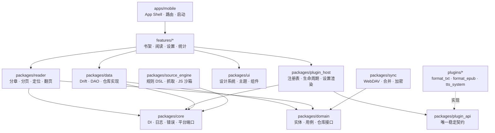
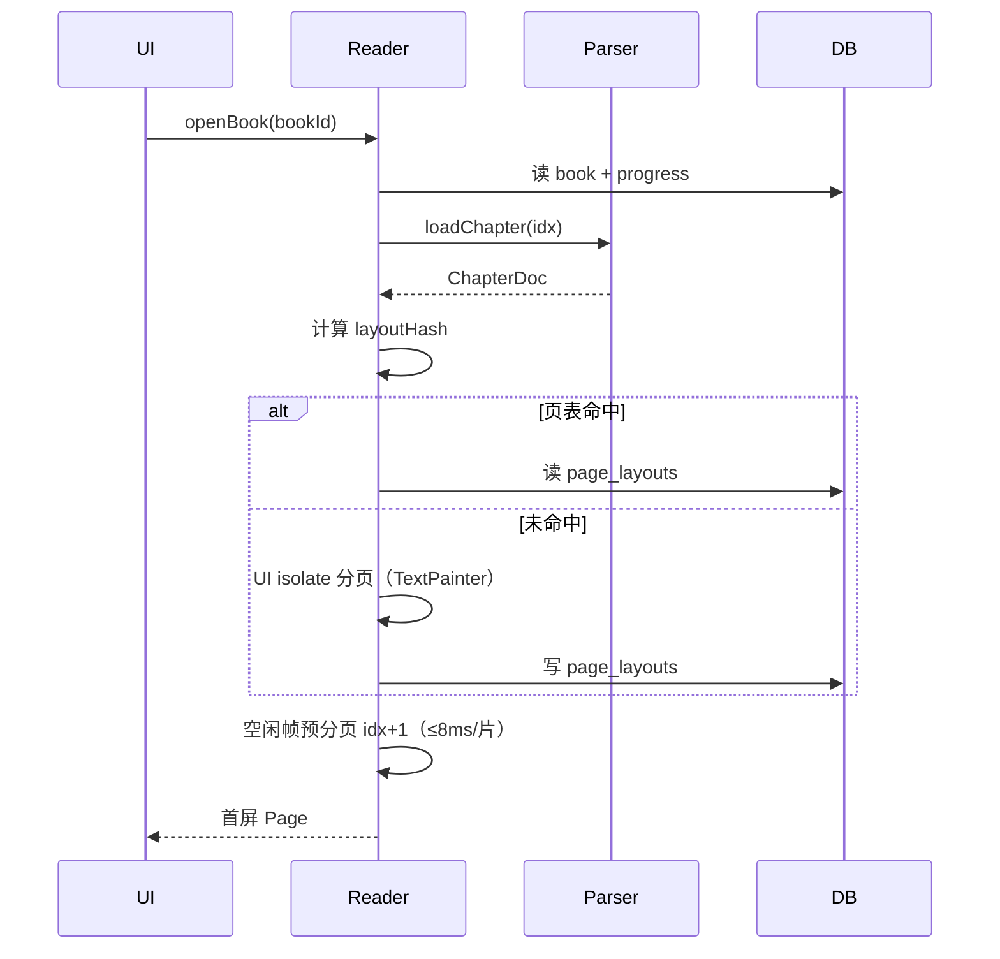

# modoo_reader 开发计划

| 项 | 内容 |
| --- | --- |
| 文档版本 | v0.1（草案，待评审） |
| 最后更新 | 2026-10-31 |
| 仓库 | `modoo_reader` |
| 许可证 | MIT |
| 目标版本 | `v0.1.0` MVP（2027-02 初，13 周）→ `v1.0.0`（2027-04 底） |
| 文档状态 | 需求已通过两轮访谈确认；第 0.3 节的 4 个决策需要你点头 |

---

## 0. 摘要

### 0.1 一句话

**modoo_reader 是一个本地优先、插件化、把中文排版和沉浸式阅读体验当作核心竞争力的开源小说阅读器。**

### 0.2 关键决策一览

| # | 决策 | 结论 | 理由 |
| --- | --- | --- | --- |
| D1 | 产品定位 | 只做「读」的工具，不做内容分发 | 规避版权风险，是开源阅读器唯一可持续的路线 |
| D2 | 内容来源 | 本地导入为主 + 用户自行导入书源规则 | 仓库不内置任何书源 |
| D3 | 平台顺序 | Android → 桌面 → Web | 单人开发，必须串行 |
| D4 | 插件形态 | 编译期 Dart 插件包 + 注册表，中等粒度 | Flutter 无法运行时加载 Dart 代码 |
| D5 | 插件边界 | 格式解析器 / 书源 / TTS 插件化，排版与阅读 UI 内聚 | 排版是产品命脉，不适合外置 |
| D6 | 技术栈 | Riverpod + Drift + go_router + freezed | 类型安全、可测试、与插件分层契合 |
| D7 | 仓库 | melos monorepo | 插件独立版本与独立测试的前提 |
| D8 | 渲染路线 | 先流式滚动跑通，再自研分页 | 3 个月内不可能同时做对两件事 |
| D9 | 同步 | 仅 WebDAV（用户自备），无自建后端 | 零运维、零隐私争议 |
| D10 | 商业模型 | 无广告、无内购、无遥测 | 与 MIT + 开源社区信任一致 |

### 0.3 已确认的 4 个决策（2026-10-31 确认）

这 4 条是从需求里推出来的、影响架构与排期的前提，**已于 2026-10-31 全部确认**。后文所有设计都以此为基础；若日后要推翻，代价写在每条的括号里。

1. **段评按「本地段落批注」实现，不做社交段评。** 你选了段评，但同步只有 WebDAV、没有后端；社交段评必须有服务端与用户体系。当前设计=长按段落写个人批注 + 生成书摘卡片分享图。（改成社交段评：需要后端 + 账号体系，MVP 排期失效，整份计划重写。）
2. **MVP 不含书源引擎。** 书源规则引擎（JSON DSL + JS 沙箱）单独占 6 周，放进 MVP 会直接击穿 3 个月。MVP = 纯本地 TXT/EPUB 阅读器，书源在 `v0.5.0-beta`。（书源进 MVP：MVP 推迟到约 4.5 个月，格式覆盖与笔记功能要砍。）
3. **Web 端排在 `v1.0.0` 之后。** 你勾了 Web，但 Web 没有 `dart:io`、没有 isolate、数据库要换 sqlite-wasm + OPFS，等于第二个产品。计划里只做「不让 Web 端返工」的抽象，不做实现。（Web 进 v1.0：v1.0 至少 +8 周，需先做文件系统抽象层。）
4. **中文名用「墨读」。** `modoo` 音近「墨读」，与包名/仓库名不冲突。（换名字：只影响文档与商店文案，代码不动。）

### 0.4 最大的风险

**范围。** 你勾选的格式有 6 种、平台 3 个、功能 16 项，而资源是「单人 + 每周 10~15 小时 + 3 个月」。本计划的做法是：**用里程碑把范围切成 6 段，每段都有可发布的产物**，任何一段延期只影响该段，不推翻整体。第 5.5 节给了明确的裁剪规则。

---

## 1. 项目定位

### 1.1 要解决的问题

现有中文阅读器大致分两类，各自都有明显缺口：

| 现状 | 缺口 |
| --- | --- |
| 番茄/七猫这类免费阅读 App | 内容绑定平台、有广告、有账号、不能读自己的书 |
| 「阅读」(legado) 这类开源书源阅读器 | 功能极强但 UI 停留在 2019 年，排版粗糙，新人上手门槛高 |
| 静读天下/Moon+ 这类老牌本地阅读器 | 中文排版细节（标点挤压、避头尾、段距）做得不够，交互不现代 |
| Apple Books/Kindle | 生态封闭，TXT/GBK 支持差，中文网络小说场景几乎不可用 |

`modoo_reader` 的切口：**拿走番茄的交互手感，拿走 legado 的开放性，但只做本地阅读，不碰内容。**

### 1.2 目标用户

| Persona | 特征 | 核心诉求 | 对应功能 |
| --- | --- | --- | --- |
| 囤书党 | 手机里存了几百个 TXT，来源杂乱、编码混乱 | 一键导入、自动识别编码与章节、书架好管理 | 导入管线、切章、书架 |
| 排版挑剔者 | 对行距、字体、段距敏感，长期夜间阅读 | 排版可调、翻页跟手、护眼 | 排版引擎、翻页动画、色温 |
| 通勤听书党 | 地铁上不方便看屏幕 | 后台 TTS、锁屏控制、断点续听 | TTS 插件、播放队列 |
| 极客/贡献者 | 想加自己的格式或书源 | 插件 API 清晰、能本地开发调试 | 插件 SDK、示例插件 |

### 1.3 竞品对照

| 维度 | 番茄小说 | 阅读(legado) | 静读天下 | modoo_reader（目标） |
| --- | --- | --- | --- | --- |
| 内容来源 | 平台自有 | 用户书源 | 本地 | 本地 + 用户书源 |
| 开源 | 否 | 是 | 否 | **是（MIT）** |
| 中文排版 | 中 | 弱 | 中 | **强（重点投入）** |
| 上下滑沉浸阅读 | 强 | 无 | 无 | **强** |
| 插件体系 | 无 | 规则 DSL | 无 | **Dart 插件 + 规则 DSL** |
| 广告/账号 | 有 | 无 | 无 | **无** |
| 多端 | 移动 | 移动 | 移动 | 移动 → 桌面 → Web |

### 1.4 非目标（明确不做）

写下来是为了在 issue 里能一句话拒绝，也是防止自己中途跑偏：

- ❌ 书城、推荐信息流、榜单（你也没勾，很好）
- ❌ 社交段评、书友圈、评论审核
- ❌ 签到、金币、广告、内购
- ❌ 账号体系、自建云服务
- ❌ DRM 破解、正版内容抓取、内置任何书源
- ❌ PDF 重排（只做固定版式缩放阅读）
- ❌ 竖排文本、Ruby 注音（`v1.0` 后作为研究项）
- ❌ iOS 首发（无 macOS 构建环境时不做承诺）

---

## 2. 需求清单

### 2.1 功能矩阵

优先级：**P0** = MVP 必须有；**P1** = `v1.0` 前完成；**P2** = `v1.0` 之后（最早 M6），只有前面里程碑提前完成才提前做。

| 模块 | 功能 | 优先级 | 里程碑 | 说明 |
| --- | --- | --- | --- | --- |
| 书库 | 书架网格/列表、封面、阅读进度、排序、分组标签 | P0 | M1 | 番茄式封面流 |
| 书库 | 多选删除、批量操作、回收站 | P1 | M2 | 防误删 |
| 导入 | 文件选择、多选、文件夹扫描 | P0 | M1 | `file_picker` |
| 导入 | TXT 编码嗅探（UTF-8/GBK/GB18030/BOM/UTF-16） | P0 | M1 | 中文场景刚需 |
| 导入 | 自动切章（章/卷/回/节 正则 + 目录识别） | P0 | M1 | 失败可手动指定正则 |
| 导入 | EPUB 解析（OPF/spine/NCX/封面/内嵌字体） | P0 | M2 | 先纯文本+章节，CSS 子集后补 |
| 导入 | Markdown / HTML | P1 | M3 | 复用同一套文本管线 |
| 导入 | CBZ / 图片文件夹（漫画） | P2 | M6 | 独立阅读模式 |
| 导入 | PDF（固定版式只读） | P2 | M6 | `pdfx` 渲染页图 |
| 导入 | MOBI / AZW3 | P2 | M6 | 先评估第三方解析可行性，再决定自研或放弃 |
| 阅读 | 上下滑动无缝阅读、章末自动衔接 | P0 | M1 | **核心差异化** |
| 阅读 | 左右翻页：覆盖 / 滑动 | P0 | M2 | |
| 阅读 | 仿真翻页（curl） | P2 | M6 | 用 shader 或网格形变，低端机自动降级 |
| 阅读 | 点按翻页、中间唤出菜单、长按选中 | P0 | M1 | 手势分区可配置 |
| 阅读 | 双指捏合调字号 | P1 | M2 | |
| 排版 | 字体、字号、行距、段距、首行缩进、对齐、页边距 | P0 | M2 | 见 §3.5.3 |
| 排版 | 标点挤压、避头尾 | P1 | M5 | 中文排版的核心质感 |
| 排版 | 主题：日间/夜间/护眼/羊皮纸 + 色温调节 | P0 | M1 | |
| 导航 | 目录、进度条拖动、章节跳转、返回原位 | P0 | M1 | |
| 导航 | 全书搜索（索引 + 高亮 + 结果列表） | P1 | M2 | 大文件需分片索引 |
| 标注 | 书签 | P0 | M2 | |
| 标注 | 划线、段落批注、笔记列表、导出 MD | P1 | M5 | 「段评」的本地化实现 |
| 标注 | 书摘卡片分享图 | P2 | M6 | 对标番茄分享样式 |
| 听书 | TTS 朗读、断句优化、语速/音色、定时关闭 | P1 | M4 | 系统 TTS + 插件化引擎 |
| 听书 | 后台播放、锁屏控制、耳机线控 | P1 | M4 | `audio_service` 或自建 |
| 统计 | 阅读时长、字数、连续天数、目标 | P1 | M2 | 番茄式数据面板 |
| 同步 | WebDAV 同步进度/书签/笔记/设置 | P1 | M5 | 冲突合并见 §3.8 |
| 同步 | 可选端到端加密 | P2 | M6 | |
| 书源 | 规则导入（JSON/URL）、校验、启用/禁用 | P1 | M4 | 不内置任何源 |
| 书源 | 搜索、详情、目录、正文抓取 | P1 | M4 | |
| 书源 | JS 脚本规则、QuickJS 沙箱 | P1 | M4 | |
| 书源 | 规则调试面板（请求/选择器/输出逐步查看） | P2 | M6 | 决定生态质量，但依赖书源引擎先稳定 |
| 插件 | 插件注册表、能力发现、设置项自动渲染 | P1 | M4 | |
| 插件 | 插件 SDK 文档 + 3 个示例插件 | P1 | M4 | |
| 设置 | 全局默认（翻页方式、字号、主题） | P0 | M1 | |
| 设置 | 数据备份/恢复（导出 DB + 配置文件） | P1 | M3 | |
| 无障碍 | 系统字体缩放、TalkBack 语义标签、对比度 | P1 | M3 | |
| 多端 | 桌面窗口、快捷键、拖拽导入 | P1 | M5 | |
| 多端 | Web 端（sqlite-wasm + OPFS） | P2 | M6+ | 只预留抽象 |
| i18n | ARB 架构 + 中文文案，英文占位 | P0 | M0 | 先只出中文 |

### 2.2 关键用户故事

1. 作为囤书党，我把 20 个 TXT 拖进书架，**不手动选编码**，就能看到正确的章节名。
2. 作为排版挑剔者，我把行距调到 1.8、段距 12px、思源宋体，切章后**滚动位置不跳**。
3. 作为通勤党，我滚到章节末尾，**下一章自动接上**，不需要点「下一章」。
4. 作为通勤党，我锁屏后 TTS **继续朗读**，耳机暂停键能停。
5. 作为标注党，我长按一段写批注，之后在笔记页能按书筛选、导出成 Markdown。
6. 作为多设备用户，我在手机上读到 43%，在平板上打开就是 43%。
7. 作为极客，我写一个 `format_fb2` 插件包，跑 `dart run tool/new_plugin.dart --name format_fb2`，半小时能跑通示例。
8. 作为隐私敏感者，我断网也能用，设置里能确认「本 App 从未上传任何数据」。

### 2.3 MVP 验收标准（Definition of Done）

`v0.1.0` 必须同时满足：

| # | 标准 | 度量 |
| --- | --- | --- |
| 1 | 冷启动到书架可交互 | 中端机（骁龙 6 系）≤ 2.0s |
| 2 | 导入 20MB / 300 万字 TXT | ≤ 5s，不 ANR，进度可见 |
| 3 | 打开任意章节 | ≤ 300ms |
| 4 | 上下滑动阅读 | 稳定 60fps，掉帧率 < 5% |
| 5 | 左右翻页动画 | p95 帧时间 ≤ 16.7ms |
| 6 | 修改字号/字体后重排 | ≤ 1.5s（当前章） |
| 7 | 进程被杀后重开 | 恢复到同一章、同一屏首行 |
| 8 | 24 小时浸泡测试 | 0 崩溃、内存无持续增长 |
| 9 | 覆盖测试 | core/reader/plugins/format_* ≥ 70% |
| 10 | 可安装产物 | GitHub Release 提供 arm64 APK，体积 < 25MB |

### 2.4 范围裁剪记录

被砍掉或降级的需求，以及原因 —— 便于日后回溯：

| 愿望 | 裁决 | 原因 |
| --- | --- | --- |
| 所有功能插件化 | 降级为「解析器 + 书源 + TTS 插件化」 | 排版/阅读 UI 外置会让性能与一致性失控，且插件 API 会在 3 个月内反复破坏 |
| 运行时热更新插件 | 放弃 | Flutter/Dart 无法运行时加载代码；改用「数据驱动」（书源规则/主题/字体可热更新） |
| 6 种格式同批交付 | 分 3 批 | TXT/EPUB 是 90% 场景；PDF/MOBI 是另一套渲染范式 |
| 社交段评 | 降级为本地批注 | 无后端，且涉及内容审核 |
| iOS 首发 | 移出计划 | 需要 macOS + 开发者账号 |
| 书城/推荐流 | 放弃 | 无内容、无推荐数据、且引流向盗版 |

---

## 3. 架构设计

### 3.1 设计原则

1. **阅读路径零阻塞**：翻页链路上不允许出现 I/O、JSON 解析、数据库同步查询。
2. **纯数据计算在 isolate，文本布局在 UI isolate**：解码、解压、切章、JSON/HTML 解析走 `Isolate.run`；但 `TextPainter.layout` / `computeLineMetrics` 依赖 UI isolate 的字体环境，**分页只能在 UI isolate 做**，用空闲帧分片，不要试图搬进后台 isolate。
3. **平台能力走端口（Port）**：`FileSystemPort`、`ClipboardPort`、`TtsPort`、`NetworkPort` 全部抽象，为 Web 端留后路。
4. **插件只依赖 `plugin_api`**：插件包不得 import `core`、`data`、`reader`，否则 API 一改全崩。
5. **一段文本只有一个真相**：章节正文以「文件偏移 + 章节区间」为唯一来源，分页结果只是缓存。
6. **一切可卸载**：插件、书源、主题都能禁用而不影响主流程。

### 3.2 分层与依赖



**依赖规则（用 `custom_lint` 强制）：**

```
plugin_api  ←  plugins/*, plugin_host
core        ←  所有业务包（plugin_api 与 plugins/* 除外；core 不依赖任何业务包）
domain      ←  data, reader, sync
source_engine ← core, plugin_api（不依赖 domain：书源规则不该被业务实体绑死）
reader      不依赖 data（只依赖 domain 的仓库接口）
features    不直接 import plugins/*
plugins/*   不得 import core / data / reader / features
```

### 3.3 仓库结构

```
modoo_reader/
├─ apps/
│  └─ mobile/                 # 主 App（Android，M5 起兼容桌面）
│     └─ lib/src/             # 启动、路由、features/（feature-first，见 CODE_STYLE §3.4）
├─ packages/
│  ├─ core/                   # DI、日志、错误模型、平台端口（路由在 app 壳）
│  ├─ domain/                 # 纯 Dart：实体、用例、仓库接口
│  ├─ data/                   # Drift schema、DAO、仓库实现、迁移
│  ├─ ui/                     # 设计系统、主题、通用组件
│  ├─ reader/                 # 阅读引擎（分章、分页、定位、动画、选中）
│  ├─ plugin_api/             # 插件契约（独立 SemVer）
│  ├─ plugin_host/            # 注册表、能力查询、插件设置
│  ├─ source_engine/          # 书源 DSL、抓取、QuickJS 沙箱
│  ├─ sync/                   # WebDAV、合并、可选加密
│  └─ l10n/                   # ARB 与生成代码
├─ plugins/
│  ├─ format_txt/             # P0
│  ├─ format_epub/            # P0
│  ├─ format_markdown/        # P1
│  ├─ tts_system/             # P1
│  ├─ format_cbz/             # P2
│  ├─ format_pdf/             # P2
│  └─ example_hello/          # 插件模板，M4
├─ docs/
│  ├─ DEVELOPMENT_PLAN.md     # 本文档
│  ├─ CODE_STYLE.md           # 代码规范（M0 起强制）
│  ├─ GIT_WORKFLOW.md         # GitHub 推送、PR、发版规则
│  ├─ adr/                    # 架构决策记录
│  └─ plugin-sdk/             # 插件开发指南
├─ tool/                      # 代码生成、插件脚手架、规则校验
├─ .github/workflows/
├─ AGENTS.md                  # AI 编码代理操作手册
├─ melos.yaml
├─ analysis_options.yaml
├─ THIRD_PARTY.md             # 依赖与许可清单
├─ CHANGELOG.md
├─ LICENSE
└─ README.md
```

### 3.4 插件系统

#### 3.4.1 为什么是「编译期插件」

Flutter 不支持运行时加载 Dart 代码（`dart:mirrors` 在 AOT 下不可用，iOS 禁止下载可执行代码）。所以「插件」在本项目里的准确含义是：

> **一个独立发布、独立版本、通过注册表挂载到主程序的 Dart 包。**

这带来三个必须接受的事实：

- 用户**不能**自己装插件，只能升级 App；
- 贡献者通过 PR 把插件并入仓库，或发布到 pub.dev 由主程序可选依赖；
- 插件能力的扩展**不依赖 App 发版**的只有「数据」：书源规则、主题、字体。

取舍已确认：优先代码质量与类型安全，放弃热插拔。

#### 3.4.2 能力接口

`plugin_api` 定义 4 类能力，插件实现其中一类或多类：

```dart
/// 1. 格式解析：把文件变成章节与文本
abstract interface class BookFormatParser {
  String get formatId;              // 'txt' | 'epub' | 'cbz'
  Set<String> get extensions;       // {'.txt'}
  String get displayName;
  Future<ProbeResult> probe(FileHandle file);
  Future<ImportResult> import(FileHandle file, ImportSink sink); // 流式上报进度
  Future<ChapterDoc> loadChapter(BookRef book, ChapterRef chapter);
}

/// 2. 书源：规则驱动的搜索/目录/正文
abstract interface class BookSourceProvider { ... }

/// 3. TTS 引擎：把句子变成可播放的语音
abstract interface class TtsEngine {
  Future<void> speak(Utterance u);
  Stream<TtsEvent> get events;
}

/// 4. 同步后端（预留，M5 只有 WebDAV 一个实现）
abstract interface class SyncBackend { ... }
```

#### 3.4.3 清单与注册

```dart
final class TxtFormatPlugin implements ModooPlugin {
  @override
  PluginManifest get manifest => const PluginManifest(
        id: 'modoo.format.txt',
        name: 'TXT 格式',
        version: '1.0.0',
        sdkConstraint: '>=1.0.0 <2.0.0',
        capabilities: {BookFormatParser},
        // 设置项用 schema 描述，宿主自动渲染，插件不写 UI
        settings: [
          SelectSetting(id: 'defaultEncoding', label: '默认编码',
              options: ['auto', 'utf-8', 'gbk']),
        ],
      );

  @override
  Future<void> register(PluginContext ctx) async {
    ctx.bind<BookFormatParser>(TxtParser(charsets: ctx.charsets));
  }
}
```

注册表在启动时装配（入口符号 `buildPluginRegistry()`，由 `tool/gen_registry.dart` 生成，命令 `melos run gen-registry`，`melos run gen` 会带上它，避免手写遗漏）：

```dart
final registry = buildPluginRegistry(); // 生成文件，勿手改
await registry.initialize();            // 校验 sdkConstraint，失败则标记 disabled 而非崩溃
```

#### 3.4.4 插件失败隔离

| 故障 | 行为 |
| --- | --- |
| `sdkConstraint` 不满足 | 插件标记 `incompatible`，不加载，设置页灰显 |
| `register()` 抛异常 | 捕获并记录，其他插件继续 |
| `import()` 超时（>60s） | 取消 isolate，该次导入失败，书架不落库 |
| `loadChapter()` 抛异常 | 阅读页显示错误态 + 「报告问题」，可切换渲染降级 |
| 插件被禁用 | 该书标记 `formatUnavailable`，可重新启用后恢复 |

**原则：任何插件都不能让 App 白屏。**

#### 3.4.5 API 稳定性策略

- `plugin_api` 独立版本号，遵循 SemVer；`1.0.0` 前允许破坏性变更，但每次破坏必须写 `docs/adr/` 并在 CHANGELOG 标注 `BREAKING`。
- `v1.0.0` 后：新增能力用 `2.x`，删除/改签名必须 `3.0.0`，且提供 ≥ 2 个小版本的弃用期。
- 插件模板与示例随 API 同步更新，CI 跑「示例插件编译 + 集成测试」防止 API 腐化。

### 3.5 阅读引擎

这是整个项目最难、也最值得投入的部分。

#### 3.5.1 文档模型

```
Book (元数据)
 └─ Chapter (章节：标题 + 在文件中的字节区间 / EPUB 的 href)
     └─ ChapterDoc (加载后的文本块列表)
         └─ Page (由 layout 决定，纯缓存，不落业务语义)
```

正文唯一真相是 `(bookId, chapterIndex, charOffset)`；分页结果只是 `layoutHash` 下的派生缓存。

#### 3.5.2 分章（导入期一次性完成）

| 格式 | 策略 |
| --- | --- |
| TXT | 先解码（编码嗅探 → 全量转 UTF-8），再用章节正则扫描：`^\s*(第[0-9零一二三四五六七八九十百千]+[章节卷回]\|序章\|楔子\|番外\|Chapter\s+\d+)`。命中率 < 阈值时回退到「按 3000 字切分」。 |
| EPUB | 直接读 `spine` 顺序，章节 = spine item，标题取 NCX/nav。 |
| MD | 按 `#`/`##` 标题切。 |
| CBZ | 章节 = 压缩包内目录或按 20 页分组。 |

大文件必须流式：`RandomAccessFile` 分块读取，逐块匹配正则，记录每章起止偏移，避免把 50MB 全读进内存。

#### 3.5.3 分页算法

```
输入：章节文本、LayoutSpec（宽高、字体、字号、行距、段距、缩进、对齐、页边距）
输出：Page[]，每页记录 (startOffset, endOffset, 首行基线, 末行底线)

1. 把章节切成段落 → TextSpan（保留粗体/斜体/标题等样式 run）
2. 逐段 TextPainter.layout(maxWidth) 得到 Paragraph
3. computeLineMetrics() 取每行高度与基线
4. 贪心装箱：累计高度 + 段距 ≤ 可用高度 → 归入当前页
5. 记录每页的行区间 → 命中测试、选中、进度都基于它
```

关键设计：

- **layoutHash** = `hash(LayoutSpec 全字段 + 排版开关位图 + 字体文件版本)`。LayoutSpec 全字段 = 字体、字号、行高、**段距**、首行缩进、对齐、页宽、页高、页边距；开关位图 = 标点挤压、避头尾、中英混排加空、简繁转换。**任何影响行盒的字段漏进 hash，旧页表就会错位** —— 这是后续改动最容易踩坏的一条，改排版必须同步改 hash 定义。
- **页表落库**（`page_layouts` 表），同一本书换设备/重进 App 也能秒开。
- **只缓存当前章 ±2 章**，LRU 上限 5 章；其余靠重算（单章 < 300ms 可接受）。
- **预分页**：进入第 N 章后，在 UI isolate 的**空闲帧**（`SchedulerBinding.scheduleIdleCallback`，每片 ≤ 8ms）分片预处理第 N+1 章，实现「章末无缝衔接」。不要放后台 isolate —— `TextPainter` 拿不到那里的字体环境。

#### 3.5.4 进度与定位

- 进度 = `(chapterIndex, charOffset) + 全书字符权重`，百分比按字符数加权，不按页数（页数会随字号变）。
- 滚动模式：记录「当前屏首行的字符偏移」，而不是像素 `offset`，否则换字号就漂移。
- 选中：跨页选中以「起止字符偏移 + 页内行矩形」表达，避免像素坐标。

#### 3.5.5 翻页动画

| 模式 | 实现 | 阶段 |
| --- | --- | --- |
| 上下滚动（默认） | `ListView`/`CustomScrollView` + 章节拼接 + 预加载 | M1 |
| 覆盖（cover） | `PageView` + `AnimatedBuilder` 位移/透明度 | M2 |
| 滑动（slide） | `PageView` + 自定义 `PageTransformer` 等效实现 | M2 |
| 无动画 | 直接切页 | M2 |
| 仿真（curl） | 片元着色器做页面弯曲 + 阴影，或网格 `Mesh` 变形 | M6 |
| 自动降级 | 帧时间连续 30 帧 > 20ms → 提示并降级到滑动 | M6 |

仿真翻页放最后不是偷懒：它是纯视觉收益、性能风险最高、且与「上下滑」定位冲突，优先级天然靠后。

#### 3.5.6 排版细节（中文专项）

放在 `reader` 的 `TextLayoutEngine` 里，按开关逐步启用：

1. 首行缩进 2em（可关，英文/代码场景需要关）
2. 段间距独立于行距
3. 标点挤压：`，。、；：」』）` 等压缩半边字宽
4. 避头尾：行首禁止 `，。、」』）》`，行尾禁止 `「『（《`
5. 中英混排自动加 1/4 空格
6. 两端对齐（`TextAlign.justify` 在 Flutter 支持有限，需自研行尾拉伸）

第 3、4、6 项是「看起来专业」和「看起来像学生作业」的分水岭，M5 集中投入。

### 3.6 格式插件策略

| 格式 | 难度 | 方案 | 阶段 |
| --- | --- | --- | --- |
| TXT | ★★ | 自研：编码嗅探 + 流式切章。编码检测候选 `charset_converter` / `fast_gbk`，M0 验证后定。注意 `charset_converter` 是 platform channel，**只能在主 isolate 调用**；要在后台 isolate 做嗅探就得用纯 Dart 实现 | M1 |
| EPUB | ★★★ | 候选 `epubx`（解析 OPF/spine/NCX）或自研；正文先「纯文本 + 标题 + 图片占位」，CSS 只支持 `text-align/font-weight/font-style/margin/blockquote/hr` | M2 |
| MD / HTML | ★ | `markdown` 包转 AST → 统一文本块模型 | M3 |
| CBZ | ★★ | `archive` 解压 + 图片列表 + 预加载 + 双页/裁边 | M6 |
| PDF | ★★★★ | `pdfx`（PDFium）逐页渲染为图片，固定版式，独立阅读模式，不做重排 | M6 |
| MOBI/AZW3 | ★★★★★ | PalmDOC 解压 + Huff/CDIC + KF8 结构，工作量大、生态弱。M6 先做 2 周技术验证，不达标就**明确放弃**并在 README 说明 | M6 |

> 对 MOBI 的态度要提前说清楚：这是一个可能「投入 3 周只换来 60% 兼容」的坑。计划允许它失败。

### 3.7 书源规则引擎

#### 3.7.1 定位澄清

「编译期插件」与「书源 JS」不矛盾：

- **插件 = 代码**（编译期，Dart）；
- **书源 = 数据**（运行时，JSON + 可选 JS 脚本，由内置 `source_engine` 用 QuickJS 执行）。

所以用户可以随时导入/删改书源，而 App 本身不需要重新编译。

#### 3.7.2 规则模型（参考 legado，做减法）

```jsonc
{
  "id": "example.source",
  "name": "示例书源",
  "baseUrl": "https://example.com",
  "charset": "utf-8",
  "enabled": true,
  "headers": { "User-Agent": "Mozilla/5.0 ..." },
  "rules": {
    "search": {
      "url": "/search?q={{key}}&page={{page}}",
      "list": "css:.result-item",
      "name": "css:.title@text",
      "author": "css:.author@text",
      "bookUrl": "css:a@href",
      "cover": "css:img@src"
    },
    "detail": { "url": "{{bookUrl}}", "intro": "css:.intro@text", "tocUrl": "css:#toc@href" },
    "toc": { "list": "css:.chapter a", "title": "@text", "url": "@href" },
    "content": { "text": "css:#content@text", "nextPage": "css:a.next@href" }
  }
}
```

选择器语法：`css:` / `json:` / `regex:` / `js:` 四种前缀。足够覆盖 90% 站点，又不至于变成一门语言。

#### 3.7.3 执行管线

```
用户输入关键词
  → 请求构建（模板变量 {{key}} {{page}} {{bookUrl}}）
  → HTTP（dio + cookie + 重试 + 超时 + 编码转换）
  → 选择器求值（html 包 / jsonpath / 正则）
  → 归一化（去空白、相对 URL 转绝对、HTML 转纯文本）
  → 结果返回；正文额外走「分页抓取 + 本地缓存」
```

#### 3.7.4 JS 沙箱与安全

书源来自不可信第三方，这是一条真正的攻击面：

| 风险 | 对策 |
| --- | --- |
| 恶意脚本读文件 | 不注入 `dart:io`，只暴露白名单全局函数 |
| 死循环卡死 | 每次 `eval` 限 5s，超时销毁 VM |
| 内存炸弹 | VM 内存上限 + 返回字符串长度上限（如 2MB） |
| SSRF/内网探测 | 域名/IP 黑名单：拒绝 `127.0.0.0/8`、`10/8`、`172.16/12`、`192.168/16`、`169.254/16` |
| 高频请求打崩目标站 | 全局并发 ≤ 3，同域 ≥ 1s 间隔，`Retry-After` 尊重 |
| 抓取到违规内容 | 不内置源 + 用户自担 + README 免责 + 可一键清空全部源 |

#### 3.7.5 调试面板（P2 但很关键）

书源生态能不能起来，取决于写源的人能不能调试。面板需要：原始请求 → 原始响应（截断）→ 每个选择器的命中数 → 最终结构化结果，逐段可见、可复制。

### 3.8 同步（WebDAV）

- **范围**：书架元数据、阅读进度、书签/笔记、设置、书源（默认关，需显式开启——涉及合规）。**不上传书籍文件**。
- **远端结构**：
  ```
  {webdav}/modoo_reader/
    ├─ library.v1.json.gz      # 快照 + revision + deviceId
    └─ backup/2026-11-20.json.gz
  ```
- **合并策略**：按记录合并，不做整包覆盖。
  - 进度：取 `(updatedAt, deviceId)` 较大者（LWW，设备时钟偏差用服务器 `Last-Modified` 校正）
  - 书签/笔记：按 id 取并集，同 id 取较新，支持墓碑删除
  - 设置：整包 LWW
- **冲突保护**：同步前本地滚动备份 1 份；远端 revision 与本地基线不一致时，先展示差异再合并。
- **加密（P2）**：AES-256-GCM，密钥由用户口令经 PBKDF2/Argon2 派生；加密整包，不泄露书名字段。

### 3.9 多端抽象

| 能力 | 移动/桌面 | Web | 端口 |
| --- | --- | --- | --- |
| 文件读取 | `dart:io` | `File System Access API` / `<input>` | `FileSystemPort` |
| 书库存储 | 应用目录 + SQLite | OPFS + sqlite-wasm | `StoragePort` |
| 大文件解析 | `Isolate.run` | 主线程分块 + `Future` 让步 | `TaskRunner` |
| TTS | 系统 TTS | Web Speech API | `TtsPort` |
| 窗口 | `window_manager` | 不适用 | `WindowPort` |

**M0 就要建立这些端口**，即使只有移动端实现，否则 Web 端要重写一半代码。

### 3.10 数据模型（Drift）

| 表 | 关键字段 | 说明 |
| --- | --- | --- |
| `books` | id, title, author, coverPath, formatId, filePath, fileHash, sizeBytes, encoding, chapterCount, addedAt, lastOpenedAt, metadataJson, deletedAt | 软删除，支持回收站 |
| `chapters` | id, bookId, idx, title, startOffset, endOffset, wordCount, level | EPUB 用 `href` 替代偏移 |
| `page_layouts` | bookId, chapterIdx, layoutHash, pageIdx, startOffset, endOffset | 复合主键，可整章删除重建 |
| `progress` | bookId(PK), chapterIdx, charOffset, percent, updatedAt, deviceId, revision | 每本书一条 |
| `annotations` | id, bookId, chapterIdx, startOffset, endOffset, excerpt, note, color, kind, createdAt, updatedAt, deletedAt | kind = bookmark / highlight / comment |
| `reading_sessions` | id, bookId, startedAt, endedAt, ms, chars | 统计原始数据 |
| `sources` | id, name, payload, type, enabled, lastTestAt, lastTestOk | 用户导入的书源 |
| `plugin_state` | pluginId(PK), enabled, settingsJson | 插件开关与配置 |
| `sync_meta` | id, remotePath, lastSyncAt, etag, deviceId | 同步基线 |

迁移：`schemaVersion` 单调递增 + 手写 `MigrationStrategy`；每次迁移必须有测试（旧库样本 → 新库校验）。

### 3.11 关键流程

**打开一本书：**



**导入一本书：**

```
选文件 → 探测格式（扩展名 + 魔数）→ 交给 format 插件
  → 后台 isolate：解码 → 切章 → 流式回传进度（文本布局不在这里，见 §3.5.3）
  → 主线程：写 books/chapters → 生成封面缩略图 → 书架插入动画
  → 失败：分类错误（编码/损坏/不支持）+ 可重试
```

---

## 4. 技术选型

### 4.1 选型表

| 领域 | 选型 | 理由 | 备注 |
| --- | --- | --- | --- |
| 语言/框架 | Flutter stable（FVM 锁定） | 单代码库覆盖 Android/桌面/Web | 版本在 M0 当天锁定并写入 CI |
| 状态管理 | Riverpod + `riverpod_generator`（`@riverpod` 代码生成） | 编译期安全、可测试、无 BuildContext 依赖，适合分层 | 锁 **3.x**：`ref.mounted` 自 3.0 起才有，2.x 无此 API |
| 路由 | go_router | 深度链接 / 书签分享需要 | |
| 数据库 | Drift（SQLite） | 类型安全、可迁移、支持 Web(sqlite-wasm) | 拒绝 Isar（维护活跃度） |
| 不可变模型 | freezed + json_serializable | 减少样板，便于插件序列化 | |
| 网络 | dio | 拦截器、取消、超时齐备 | 书源抓取强依赖 |
| HTML 解析 | html | 纯 Dart，可跑 isolate | 书源选择器基础 |
| JS 引擎 | flutter_js（QuickJS） | 跨端一致、体积可控 | 只用于书源脚本 |
| EPUB | `epubx` 或自研（M0 评估） | 自研可控但要 2-3 周 | 先用候选包验证 |
| PDF | `pdfx` | 基于 PDFium，成熟 | 仅 P2 |
| 压缩 | `archive` | CBZ/EPUB 解包 | |
| 编码 | `charset_converter` / `fast_gbk` | 中文 GBK 刚需 | M0 做对比测试 |
| TTS | `flutter_tts` + 自建播放队列 | 简单、跨端 | 后台播放另接 |
| 音频后台 | `audio_service` / `just_audio` | 锁屏与耳机控制 | M4 评估 |
| WebDAV | `webdav_client` | 协议完整 | |
| 本地化 | `intl` + ARB + `flutter gen-l10n` | 官方方案 | 中文首发 |
| Lint | `flutter_lints` + `custom_lint` 架构规则 | 用机器守住分层 | M0 建 |
| 测试 | `flutter_test`（含 `matchesGoldenFile`）+ `mocktail` + `alchemist` + `integration_test` | 覆盖三层 | golden 用 alchemist，比 golden_toolkit 维护更活跃 |

### 4.2 架构决策记录（ADR）

| 编号 | 决策 | 状态 |
| --- | --- | --- |
| ADR-0001 | 编译期 Dart 插件 + 注册表，而非运行时热插拔 | 已定 |
| ADR-0002 | 正文唯一真相用字符偏移，分页只做缓存 | 已定 |
| ADR-0003 | 书源规则作为「数据」由内置引擎执行，不作为插件代码分发 | 已定 |
| ADR-0004 | 先滚动后分页的渲染演进路线 | 已定 |
| ADR-0005 | 同步只支持 WebDAV，不自建服务 | 已定 |
| ADR-0006 | 不内置任何书源 | 已定 |
| ADR-0007 | 字体不打包进 APK，走系统字体 + 可选下载 | 待验证（体积） |
| ADR-0008 | 仿真翻页延后到 M6，且必须可降级 | 已定 |
| ADR-0009 | Riverpod 统一走 `@riverpod` 代码生成，不手写 provider；锁 **3.x**（`ref.mounted` 自 3.0 起才有） | 已定（见 CODE_STYLE §7.1、§7.3） |
| ADR-0010 | 包名统一加 `modoo_` 前缀，插件 id 用 `modoo.<能力>.<名字>` | 已定（见 CODE_STYLE §3.1、§9.2） |

> 每个 ADR 后续在 `docs/adr/NNNN-*.md` 落成正式文件（含背景、选项、后果）。

### 4.3 明确不用的技术

| 技术 | 原因 |
| --- | --- |
| Firebase / Sentry 默认上报 | 与「零遥测」承诺冲突；如需崩溃上报，必须 opt-in 且可关 |
| WebView 渲染正文（epub.js） | 翻页动画与排版无法统一，性能不可控 |
| Isar / Hive | 维护活跃度与 Web 支持不足 |
| 任何广告 SDK | 非目标 |
| 动态下发 Dart 代码 | 平台不允许 |

---

## 5. 里程碑与排期

### 5.0 本机环境现状（2026-10-31 实测）

| 组件 | 状态 | 说明 |
| --- | --- | --- |
| Flutter | ✅ 已装 | `D:\Download\Scoop\apps\flutter\current` |
| Dart | ✅ 已装 | 随 Flutter |
| Git | ✅ 已装 | Scoop |
| JDK | ✅ 17 | `D:\Download\Scoop\apps\openjdk17` |
| Gradle | ✅ 已装 | Scoop |
| Android SDK | ❌ **缺失** | `adb` 不在 PATH，`ANDROID_HOME` 未设置 |
| Gradle 缓存 / licenses | ❌ 待完成 | 首次构建前必须执行 `flutter doctor --android-licenses` |

**M0 第 0 步（约 1 小时）**：安装 Android `cmdline-tools` + `platform-tools` + `platform 35` + `build-tools`，设置 `ANDROID_HOME`，接受 licenses，`flutter doctor` 全绿。否则后面所有 APK 相关验收都无法验证。

> 提醒：本机 `flutter --version` 首次执行会拉取 Dart SDK 并构建工具快照，可能卡住数分钟，属正常现象（本次探测即因此超时），不要误判为环境损坏。

### 5.1 排期假设

- 单人开发，**每周 10–15 小时**（工作日 1–2h + 周末半天）
- 无设计稿，UI 参考番茄的交互骨架，配色/图标自建
- 总可用工时：MVP 周期约 13 周 × 12h ≈ **156h**，计划工作量 **130h**，留 20% 缓冲

工时估算表：

| 里程碑 | 内容 | 估时 | 周期 |
| --- | --- | --- | --- |
| M0 | 仓库、CI、设计系统、数据层 | 20h | 2 周 |
| M1 | 导入 + 最小阅读闭环 | 40h | 4 周 |
| M2 | 分页引擎 + 排版 + EPUB + 书签搜索 | 40h | 4 周 |
| M3 | 打磨、i18n、发布 `v0.1.0` | 30h | 3 周 |
| M4 | 插件 SDK + 书源 + TTS → `v0.5.0` | 60h | 6 周 |
| M5 | 笔记、全文搜索、同步、桌面 → `v1.0.0` | 60h | 6 周 |
| 合计 | | **250h** | **25 周** |

### 5.2 甘特图


### 5.3 里程碑明细

#### M0 · 地基（W1–W2，20h）

| 任务 | 产出 | 验收 |
| --- | --- | --- |
| 环境与仓库 | Flutter 版本锁定（FVM）、melos 初始化、目录骨架、LICENSE/README 初版 | `melos bootstrap` 成功，CI 绿 |
| 代码规范 | `analysis_options.yaml`、custom_lint 分层规则、commitlint | 故意写跨层 import 会被 lint 拦住 |
| 设计系统 | `ui` 包：色板（含夜间/护眼）、字号阶梯、间距、圆角、3 个基础组件 | 示例页可切换 4 套主题 |
| 数据层 | Drift schema v1 + DAO + 迁移测试框架 | 单测覆盖 schema |
| 平台端口 | `FileSystemPort`/`TaskRunner`/`TtsPort` 接口 + 移动端实现 | 真机读写文件通过 |
| 骨架页 | 空书架、导入入口、设置页骨架、路由 | 真机跑通空态 |
| i18n | ARB + gen-l10n + 中文文案骨架 | 切换系统语言不崩 |
| 开源治理文件 | `LICENSE`、`CONTRIBUTING.md`、`CODE_OF_CONDUCT.md`、`SECURITY.md`、`CHANGELOG.md`、`THIRD_PARTY.md` | 根目录齐全，README 里能点开 |

#### M1 · 导入与最小阅读闭环（W3–W6，40h）

| 任务 | 验收 |
| --- | --- |
| TXT 编码嗅探（UTF-8/GBK/GB18030/BOM/UTF-16） | 20 个真实样本 100% 正确 |
| 流式切章 + 自定义正则 | 300 万字 < 5s；章节名正确率 > 90% |
| 书架（网格/列表、封面、进度、排序、删除） | 500 本书滚动不卡 |
| 阅读页 v1：上下滚动、目录、进度条 | 连续滚 10 章无掉帧 |
| 排版设置 v1：字号/行距/主题 | 设置实时生效 |
| 阅读进度持久化 + 恢复 | 杀进程后位置误差 < 1 屏 |

#### M2 · 分页与体验成型（W7–W10，40h）

| 任务 | 验收 |
| --- | --- |
| 分页引擎 + 页表缓存 + 预分页 | 单章分页 < 300ms，命中 < 20ms |
| 左右翻页（覆盖/滑动/无动画） | p95 帧时间 ≤ 16.7ms |
| 排版扩展（边距/段距/缩进/对齐/字体） | 改设置 1.5s 内重排完成 |
| 书签 + 选中复制 | 跨页选中不越界 |
| 全书搜索 v1（分片索引） | 300 万字首次建索引 < 10s，搜索 < 500ms |
| EPUB 基础（spine + 标题 + 图片 + 目录） | 3 本真实 EPUB 正文章节正确 |
| 阅读统计 v1（时长/字数/连续天数） | 数据与设置页展示一致 |

#### M3 · MVP 发布（W11–W13，30h）

| 任务 | 验收 |
| --- | --- |
| 性能专项：启动、内存、首屏 | 冷启动 ≤ 2s，峰值内存 ≤ 200MB |
| 错误态与空态全覆盖 | 无白屏 |
| 无障碍：字体缩放、语义标签 | TalkBack 可完成「打开-翻页-返回」 |
| 数据备份/恢复（导出 DB） | 导出→清数据→恢复，书架一致 |
| 文档：README（截图/GIF）、CHANGELOG、CONTRIBUTING | 新人能按文档跑起来 |
| 发布：签名配置、GitHub Actions 出 APK | `v0.1.0` Release 可下载安装 |

#### M4 · 插件 SDK 与书源（W14–W19，60h）→ `v0.5.0-beta`

- `plugin_api` v1 定稿 + 注册表（`buildPluginRegistry()`）+ 插件设置自动渲染
- 插件脚手架 `dart run tool/new_plugin.dart --name <name>` + `example_hello`
- **`docs/plugin-sdk/` 首版**：能力接口、manifest 字段、设置项类型、选择器语法（与 `plugin_api` v1 一起定稿，M4 内必须存在，否则 §6.7 与插件配方无文档可指）
- 书源 DSL 解析与执行器（css/json/regex）
- QuickJS 沙箱（超时/内存/域名白名单/并发限制）
- 书源管理 UI：导入、校验、**测试**、启用、清空
- 调试面板：请求/响应/选择器命中/结果
- TTS：断句、语速、定时、后台播放、锁屏控制
- 示例插件 3 个（hello、示例书源、示例 TTS）

> ⚠️ 这 6 周横跨 2027 年春节（2/6），实际可用时间按 −1 周计。

#### M5 · v1.0.0（W20–W25，60h）

- 划线/批注/笔记列表/导出 Markdown
- 全文搜索 v2（高亮、结果上下文、跳转定位）
- WebDAV 同步（进度/书签/笔记/设置 + 冲突合并 + 滚动备份）
- 桌面端适配（窗口尺寸、快捷键、拖拽导入）
- 中文排版专项（标点挤压、避头尾、两端对齐）
- 阅读目标与统计报表
- `v1.0.0` 发布 + 文档站

#### M6 · 持续演进（`v1.0` 后）

CBZ 漫画 → PDF 只读 → MOBI 技术验证（允许失败）→ 仿真翻页 → Web 端 → 竖排/Ruby 研究。

### 5.4 里程碑闸门

每个里程碑结束做一次「继续 / 裁剪 / 返工」三选一评审，判据：

- 功能是否达到该段验收标准（不达标不进入下一段）
- 是否出现**架构级**返工信号（如分页方案不可行、插件 API 反复改）
- 剩余精力是否 ≥ 计划的 70%

### 5.5 裁剪规则（按顺序触发）

时间不够时，**从上往下砍**，不要横向砍质量：

1. 砍 MOBI/AZW3（P2，本来就可能失败）
2. 砍 PDF（P2）
3. 砍 CBZ 漫画（P2）
4. 砍仿真翻页（纯视觉）
5. EPUB 降级为「纯文本 + 章节」（不做 CSS/图片）
6. 砍全书搜索 v2（保留 v1）
7. 砍阅读统计
8. 砍桌面端
9. **绝不砍**：TXT 导入、分页正确性、进度恢复、崩溃率、中文排版基本功

---

## 6. 质量、性能与流水线

### 6.1 测试策略

```
        ▲  E2E（integration_test，5%）
       ╱ ╲   导入→阅读→翻页→重启恢复
      ╱───╲
     ╱ 组件 ╲  widget/golden（25%）
    ╱────────╲ 阅读页、设置面板、书架，固定字体做 golden
   ╱  单元    ╲ unit（70%）
  ╱────────────╲ 分章、分页算法、编码嗅探、规则求值、同步合并、迁移
```

| 层 | 范围 | 工具 | 目标 |
| --- | --- | --- | --- |
| 单元 | 解析器、分页数学、合并算法、迁移 | `flutter_test`、`mocktail` | core/reader/parsers ≥ 70% |
| 组件 | 阅读器交互、设置联动 | `widget_test` | 关键路径全覆盖 |
| 快照 | 四个主题的阅读页 | `alchemist` / `matchesGoldenFile` | 防视觉回归（固定字体，CI 用 Linux 渲染） |
| 集成 | 真机/模拟器全流程 | `integration_test` | 每次发版跑 |
| 性能 | 启动、翻页、导入 | `flutter drive` + timeline | 每里程碑跑一次并记录 |

**测试数据**：`test/fixtures/` 放 5 个真实 TXT（含 GBK/含 BOM/无章节/超大）、3 个 EPUB、2 个损坏文件。这些是长期资产，进仓库（裁剪过的小样本）。

### 6.2 性能预算

| 指标 | 目标 | 失败即视为 bug |
| --- | --- | --- |
| 冷启动到可交互 | ≤ 2.0s | > 3.0s |
| 热启动 | ≤ 800ms | > 1.5s |
| 打开章节 | ≤ 300ms | > 800ms |
| 翻页帧时间 p95 | ≤ 16.7ms | > 25ms |
| 滚动掉帧率 | < 5% | > 10% |
| 导入 20MB TXT | ≤ 5s | > 12s |
| 阅读 20MB 书峰值内存 | ≤ 200MB | > 350MB |
| APK（arm64） | ≤ 25MB | > 40MB |
| 数据库查询 | ≤ 50ms | > 200ms |

### 6.3 CI 流水线（GitHub Actions）

| 触发 | 任务 |
| --- | --- |
| PR | format check → analyze → 架构 lint → unit/widget test → 覆盖率评论 |
| push to `main` | 同上 + build debug APK |
| tag `v*` | 全量测试 → 签名 release APK/AAB → 生成 CHANGELOG → 创建 Release |
| 每周 | 依赖检查（`pub outdated`）+ 性能基准跑一次 |

签名密钥走 GitHub Secrets，**绝不进仓库**。

### 6.4 发布与分发

- `v0.x`：GitHub Release 提供 APK（arm64 + armeabi-v7a 两个变体）
- 版本号：SemVer；`0.x` 阶段 `MINOR` 可含破坏性变更，但必须在 CHANGELOG 明示
- 后续可选：F-Droid（要求从源码构建、依赖全为 FOSS，可复现构建是加分项 —— 当前选型基本满足，但 CI 需再调）
- 商店文案、截图、隐私政策页在 M3 准备

### 6.5 可观测性（隐私优先）

- 默认：**零上报**，日志只写本地文件（滚动 7 天），用户可手动导出。
- 崩溃：本地记录，下次启动提示「是否匿名发送」（opt-in，可永久关闭）。
- 设置页提供「本 App 的网络请求记录」，让隐私承诺可验证。

---

## 7. 开源治理

### 7.1 许可证

**MIT**。理由：采用门槛最低，书源/插件生态更容易长起来；不希望被闭源商用可以用商标而非许可证来约束（后续可注册项目名商标）。

配套文件：

| 文件 | 作用 |
| --- | --- |
| `LICENSE` | MIT 全文 + 版权年 |
| `NOTICE` / `THIRD_PARTY.md` | 第三方依赖与字体许可清单 |
| `CONTRIBUTING.md` | 开发环境、分支、提交规范、DCO |
| `CODE_OF_CONDUCT.md` | Contributor Covenant 2.1 |
| `SECURITY.md` | 漏洞上报渠道与响应时限 |
| `CHANGELOG.md` | Keep a Changelog 格式 |
| `.github/ISSUE_TEMPLATE/*` | bug / feature / plugin / **求书源（自动关闭模板）** |
| `.github/PULL_REQUEST_TEMPLATE.md` | 改动说明 + 测试证据 + 截图 |

### 7.2 协作规范

- **分支模型**：trunk-based。`main` 常绿，功能分支 ≤ 3 天，PR 小步合并。
- **推送与合并的执行细节**（分支保护、squash、tag、冲突与回滚）见 [GIT_WORKFLOW.md](GIT_WORKFLOW.md)。
- **提交规范**：Conventional Commits（`feat:` / `fix:` / `docs:` / `refactor:` / `perf:` / `chore:`），由 commitlint 校验。
- **PR 要求**：CI 绿 + 至少 1 次 review。单人阶段用「自查清单 + CI」替代 review，但**不绕过 CI**。
- **架构变更**：必须提 ADR，PR 里链接 ADR 编号。
- **Issue 分级**：`good first issue`、`help wanted`、`plugin`、`performance`、`i18n`。

### 7.3 社区与文档

| 渠道 | 用途 |
| --- | --- |
| GitHub Issues | bug 与功能请求（模板引导，减少无效 issue） |
| GitHub Discussions | 使用问答、插件分享、版本预告 |
| `docs/plugin-sdk/` | 插件开发指南 + API 参考（随代码生成） |
| README | 3 秒说清是什么 + GIF + 下载 + 一句「不提供任何书源」 |

**README 是转化率最高的文件**，M3 必须专门投入 2 小时写：首屏放 GIF，第二屏放特性表，第三屏放截图，最后才是构建说明。

### 7.4 插件生态计划

1. M4：`example_hello` + 脚手架 + 文档 → 让第一个外部插件能在 1 小时内跑起来
2. `v0.5`：公开征集格式插件（FB2、DOCX、TXT 增强）
3. `v1.0`：发布「插件目录」文档页（只是列表 + 链接，不做应用内市场）
4. 永不内置第三方书源；书源只以「用户导入」形式存在

---

## 8. 合规与法务

| 事项 | 措施 |
| --- | --- |
| 内容来源 | 仓库与安装包**不含任何书源、不含任何书籍内容**；书源仅由用户导入 |
| 免责声明 | README 首屏 + App 首次启动弹窗 + 设置页常驻入口 |
| 侵权投诉 | `SECURITY.md` 同级提供 `TAKEDOWN.md` 与联系邮箱，48h 内响应删除相关内容 |
| 隐私 | 无账号、无遥测、默认不联网；网络请求仅在用户主动使用书源/WebDAV 时发生 |
| 隐私政策 | 一页 Markdown，说明「数据全部留在设备上」 |
| 第三方许可 | 依赖清单自动生成并随 Release 附上；字体只用 OFL/Apache 许可 |
| 商标 | 项目名与 Logo 不授权商用背书（许可证不覆盖商标） |
| 年龄分级 | 工具类应用，无内容分级问题；但需提示「用户导入内容由用户负责」 |

**红线**：任何 PR 试图内置书源、抓取正版平台内容、绕过付费墙，一律关闭。

---

## 9. 风险登记册

| # | 风险 | 概率 | 影响 | 缓解 | 触发信号 |
| --- | --- | --- | --- | --- | --- |
| R1 | 范围过大导致 MVP 延期 | **高** | 高 | 5.5 裁剪规则；每 2 周检查进度偏差 | 里程碑完成度 < 70% |
| R2 | 分页引擎在低端机性能不达标 | 中 | 高 | 先滚动后分页；UI isolate 空闲帧分片预排版；页表缓存；降级到滚动 | 单章分页 > 500ms |
| R3 | 中文排版细节做不出质感 | 中 | 中 | M5 专项；对标微信读书截图逐项对比 | 用户反馈「排版一般」 |
| R4 | EPUB 兼容性差 | 中 | 中 | 先做「纯文本 + 章节」，CSS 子集逐步加；建 EPUB 测试集 | 3 本样本中有 1 本解析失败 |
| R5 | MOBI 解析投入产出比极差 | **高** | 低 | 限时 2 周技术验证，不达标明确放弃 | 2 周后兼容率 < 50% |
| R6 | 书源规则失效/被反爬 | 高 | 中 | 不内置源（责任转移给用户）；调试面板降低写源成本 | — |
| R7 | 插件 API 早期反复破坏 | 中 | 中 | `v1.0` 前标注 experimental；示例插件随 API 同改；CI 编译校验 | 外部插件编译失败 |
| R8 | 单人维护倦怠 | **高** | 高 | 小步发布、自动化一切重复劳动、明确非目标、每月至少发一次版 | 连续 3 周无提交 |
| R9 | 版权投诉 / 下架 | 低 | 高 | 零内置内容；README 免责；快速响应删除 | 收到投诉邮件 |
| R10 | Web 端返工 | 中 | 中 | M0 建平台端口；Web 排到 `v1.0` 后 | 新功能直接调用 `dart:io` |
| R11 | 性能回归无人发现 | 中 | 中 | 每里程碑跑基准并记录到 `docs/perf/` | 帧时间上升 > 20% |

---

## 10. 下一步 14 天（M0 行动清单）

- [ ] **D1**：确认第 0.3 节的 4 个决策（段评范围 / MVP 不含书源 / Web 排后 / 中文名）
- [ ] **D1**：`flutter --version` 确认工具链，写 `.fvmrc` 锁定版本
- [ ] **D1**：装 Android SDK（cmdline-tools / platform-tools / platform 35 / build-tools），设 `ANDROID_HOME`，`flutter doctor` 全绿
- [ ] **D1**：`git init` + 首次提交（LICENSE / README / .gitignore / analysis_options / THIRD_PARTY.md 空表）
- [ ] **D2**：melos 初始化，建 `apps/mobile` + 5 个核心包空壳
- [ ] **D2–D3**：`ui` 包：色板（日间/夜间/护眼/羊皮纸）、字号阶梯、主题切换 Demo
- [ ] **D3–D4**：`data` 包：Drift schema v1 + 迁移测试
- [ ] **D4–D5**：`core` 包：DI、日志、错误模型、平台端口（路由声明留在 app 壳）
- [ ] **D5**：GitHub Actions：analyze + test（先在本地脚本跑通）
- [ ] **D6–D7**：空书架页 + 导入入口 + 设置骨架（假数据）
- [ ] **D8–D9**：TXT 编码嗅探技术验证（准备 20 个样本，对比 2 个候选库）
- [ ] **D9**：EPUB 解析候选评估（`epubx` 能否满足 spine + 中文）
- [ ] **D10–D11**：导入 TXT → 切章 → 落库 的纵向切片（打通一条真实链路）
- [ ] **D12**：阅读页显示第一章纯文本（滚动即可，不排版）
- [ ] **D13**：M0 评审：架构是否站得住？要不要调整？
- [ ] **D14**：buffer / 补测试 / 发 `v0.0.1` 内部版本

---

## 附录 A · 术语表

| 术语 | 含义 |
| --- | --- |
| 分页（Pagination） | 把章节文本按版式切成固定高度的页，产出字符偏移区间 |
| layoutHash | 版式参数的哈希，用于让分页缓存自动失效 |
| 书源 | 一份描述「如何从某网站搜索/取目录/取正文」的规则数据 |
| 规则 DSL | 书源规则的选择器语法（css/json/regex/js） |
| LWW | Last-Write-Wins，冲突合并策略 |
| 段评 | 对本项目的本地段落批注，非社交评论 |
| 端口（Port） | 对平台能力的抽象接口，用于隔离移动/桌面/Web 差异 |
| ADR | Architecture Decision Record，架构决策记录 |

## 附录 B · 参考资料

- Flutter 官方文档：<https://docs.flutter.dev>
- Riverpod：<https://riverpod.dev>
- Drift：<https://drift.simonbinder.eu>
- melos：<https://melos.invertase.dev>
- EPUB 3 规范：<https://www.w3.org/TR/epub-33/>
- legado（阅读）书源规则参考：<https://github.com/gedoor/legado>
- QuickJS：<https://bellard.org/quickjs/>
- Contributor Covenant：<https://www.contributor-covenant.org/version/2/1/code_of_conduct/>
- F-Droid 收录政策：<https://f-droid.org/docs/Inclusion_Policy/>

---

## 变更记录

| 版本 | 日期 | 变更 |
| --- | --- | --- |
| v0.1 | 2026-10-31 | 首版：基于两轮需求访谈（产品 9 问 + 技术 9 问）成稿 |
| v0.2 | 2026-10-31 | 三文档一致性评审修正：分页限定在 UI isolate（`TextPainter` 字体环境）、layoutHash 补全字段（段距/排版开关/字体版本）、依赖表补 `core ← 所有业务包` 与 `source_engine`、注册表统一 `buildPluginRegistry()` + `melos run gen-registry`、覆盖率口径改 `plugins/format_*`、P2 归入 M6；§0.3 的 4 条决策经确认；补 ADR-0009/0010 |
| v0.3 | 2026-10-31 | 新增 `docs/GIT_WORKFLOW.md`（分支、推送、分支保护、PR、tag 发版、Git 报错处置）；§3.3 目录树与 §7.2 协作规范补引用与执行细则 |
